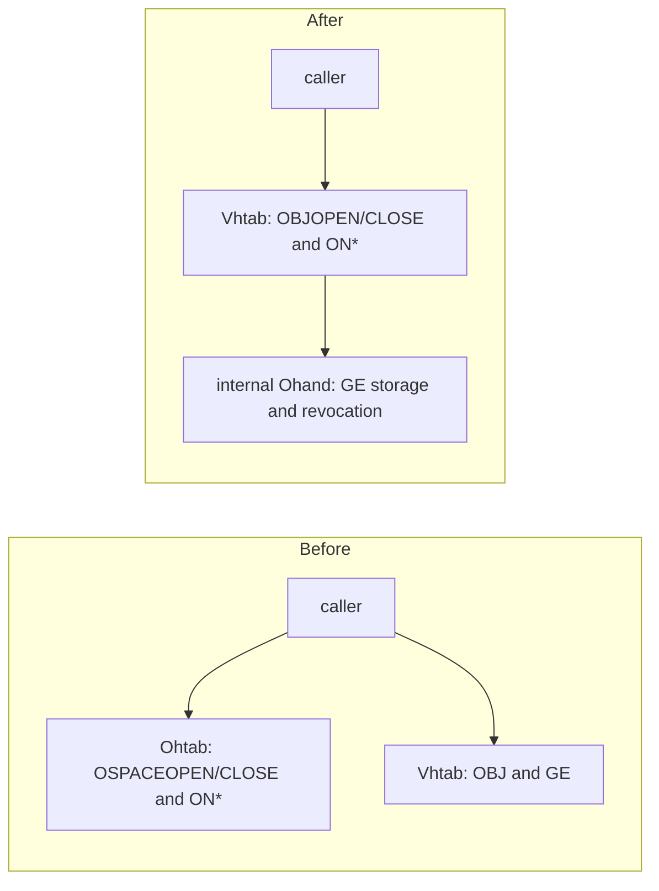

# Syscall consolidation (2026-11-08)

Source baseline: GitHub main `b558d1a97788bbc2694b4ce3c87440511a83514a`.
This branch changes the amd64 experimental ABI. Historical numbers stay
allocated and reject with `Ebadarg` when retired; they are not reused.
`runtime/abi/sys.h` marks retired numbers, and both kernel dispatch generation
and MicroPython stub generation read that one status source. A missing active
handler or an implemented reserved handler fails the build.

| Dispatch | Before | After |
| --- | ---: | ---: |
| Named numbers | 135 | 135 |
| Active | 62 | 40 |
| Reserved | 73 | 95 |

The 22 retired entries are `SYSR1`, `_ERRSTR`, `_FSESSION`, `FAUTH`,
`FVERSION`, `RTCGET`, `RTCSET`, `OSPACEGET`, `OSPACEPUT`,
`OSPACECOMMIT`, `OSPACECREATE`, `OSPACEOPEN`, `OSPACECLOSE`, `OBIND`,
and `USBOPEN` through `USBEPNAME` (eight entries). Native segment services
`SEGBRK`, `SEGATTACH`, `SEGDETACH`, `SEGFREE`, `SEGFLUSH`, semaphore
services `SEMACQUIRE`, `SEMRELEASE`, `TSEMACQUIRE`, and `RENDEZVOUS` remain
active and have their own userland operations. They manage memory and
synchronization, not objects, so there is no OBJ alias for them.

The first user loader calls `OVOLOPEN`, `OBJOPEN(ObjOpenSpace)`, and
`OEXECUTE`. MicroPython uses the same Space Handle for GE read/write/create,
commit and native namespace operations. `ObjOpenGe` is retired in favor of
`ObjOpenGeSpace`. `Proc.ohandles` and `Ohtab` are gone: the one process-visible
`Vhtab` gives generation-tagged, rights-bearing Handles to GE objects, Spaces,
namespace views and other OBJ providers. `Ohand` remains an internal authority
for GE storage, revocation and namespace membership. Direct `ON*` calls check
the same Vhand generation and rights before reaching that internal authority.

The object router no longer accepts `ObjOpTimeNow=27`,
`ObjOpErrstrExchange=29`, `ObjOpGrant=9`, or `ObjOpCreatePersist=12`.
Time and error exchange use direct `_NSEC` and `ERRSTR`. Capability copies
use `OBJOPEN(ObjOpenHandle)`; persistent creation uses
`OBJCREATE(ObjKindGe)`. Numeric operation values remain assigned but fail as
unsupported. `obj_grant` and `obj_create_persist` are userland convenience
functions over the remaining operations. `space.hput/hcommit/hcreate` were
removed; the normal Space persistence path already uses OBJ.

USB enumeration, endpoint ownership and control now use the common Vhand table.
`plan9.obj_usb_open(2248)` requests `Vmeta|Vdelegate|Vcreate|Vcontrol` from
the trusted bootstrap process. A `Vcreate` service Handle without `Vcontrol`
can open data endpoints but cannot open USBCTL endpoints. The default open is
metadata-only. A control endpoint uses `plan9.obj_usb_ctl` over
`ObjOpDeviceCtl`, whose USB branch requires `Vcontrol`, bounds the in/out
buffer to 4096 bytes, and calls the same `usbcore_ioctl` provider. Common
Device session clear-halt remains its
own operation on the same router, selected by Handle kind. `plan9.usb_*`
legacy bindings are removed; `plan9.obj_usb_*` is the public family.

The retained direct calls are small process-local operations (`BRK_`, sleep,
notes, rfork, exits, alarm, time, error), native memory/synchronization,
volume bootstrap, environment and namespace operations. The five OBJ calls manage live resources.
The deprecated native TCP/UDP provider tags remain rejected, and the native
network stack remains disabled. `ENVGET/SET/DELETE/LIST` are distinct bounded
operations; `ON*` direct calls manage the persistent namespace view, while
`OBJBIND` manages Vhand bindings. These are remaining design boundaries,
not aliases to a single operation.

Verification on the agent's Debian 13 x86_64 executor: canonical GCC kernel,
MicroPython, EFI loader and host formatter builds passed; ABI/layout and link
checks passed. Disposable QEMU/TCG boot passed through GE/O commit and REPL.
The focused USB gate passed 70 sequential assertions, and the raw Ethernet
gate passed 55 with an external peer. T16 ran actual userland segment and
semaphore calls plus GE create/read/commit, rights attenuation, a child
spawn/wait with a read-only GE Handle, cross-process isolation, namespace
revoke/stale-use checks and rejection of OSPACEOPEN/CLOSE. A second boot of
the same disk verifies restored persistence. Physical devices were not tested.
